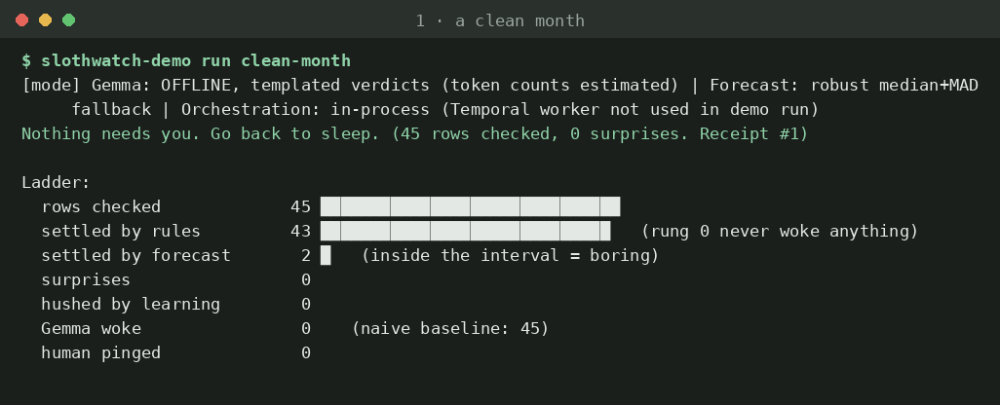
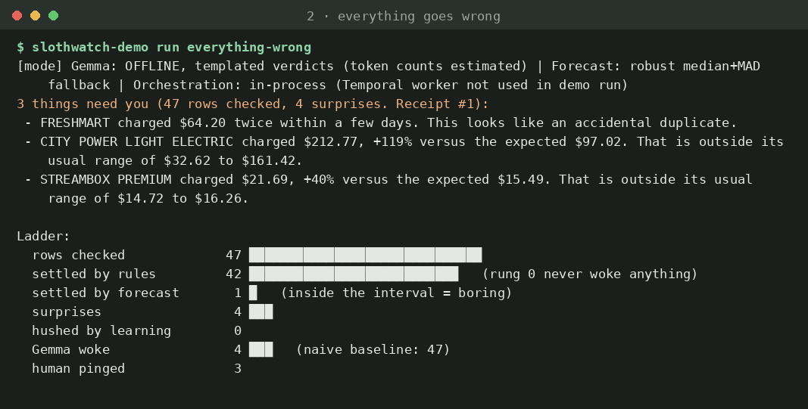
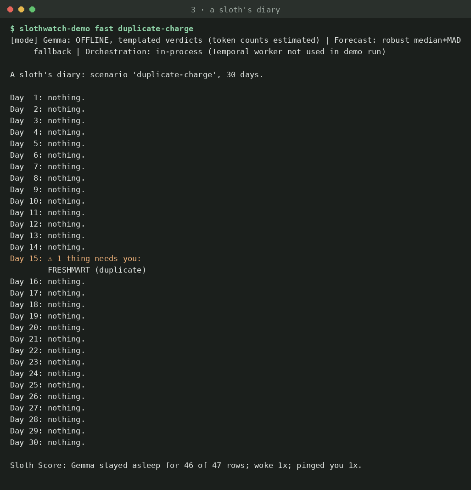
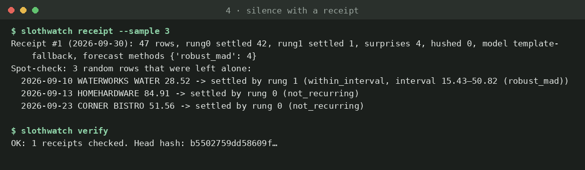
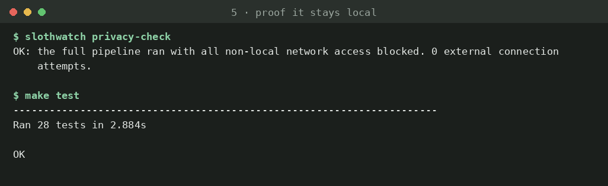
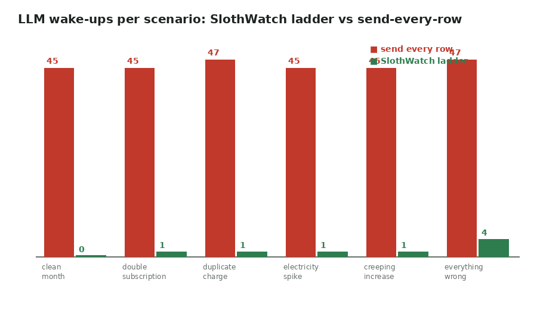
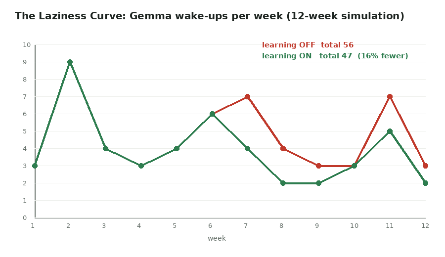

# SlothWatch 🦥  the agent whose best output is silence

A local agent that watches boring money numbers (bank CSVs) and stays quiet unless something is wrong:
**"Nothing needs you. Go back to sleep. (45 rows checked, 0 surprises. Receipt #1)"**

Two apps, one core:
- **SlothWatch (real)**: your CSVs, your schedule. State in `.slothwatch/`.
- **SlothWatch Demo**: seeded synthetic life, six scenario packs, fast-forward sloth diary, guided tour, 12-week simulation. State in `.slothwatch-demo/`.

## Screenshots

All captured from real runs of this repo (synthetic demo data). Regenerate any of them with the command shown.

**1. A clean month: silence is the product** (`slothwatch-demo run clean-month`)



**2. Everything goes wrong: the ladder wakes the model only 4 times out of 47 rows** (`slothwatch-demo run everything-wrong`)



**3. A sloth's diary: 30 days, one line per day** (`slothwatch-demo fast duplicate-charge`)



**4. Silence with a receipt: spot-check three ignored rows and verify the hash chain** (`slothwatch receipt --sample 3`, `slothwatch verify`)



**5. Proof it stays local: pipeline runs with all external network blocked; 28 tests pass** (`slothwatch privacy-check`, `make test`)



**6. Benchmark: model wake-ups per scenario, ladder vs send-every-row** (`slothwatch bench`)



**7. The Laziness Curve: wake-ups per week with learning on vs off** (`slothwatch-demo sim`)



> Dashboard screenshots: run `make demo` and open `http://127.0.0.1:8766/#Today`, `#Alerts`, `#Receipts` (tabs deep-link by hash), then save images to `docs/screenshots/`.

## The Sloth Ladder
Rung 0 rules → Rung 1 TabPFN interval → Rung 1.5 "does this person care?" (learns from your decisions) → Rung 2 Gemma (local) →
Rung 3 you (approve / ignore / snooze; nothing is ever sent). Each rung exists to avoid waking the next. Every run, quiet or not,
writes a hash-chained **Silence Receipt**; a weekly **canary** proves the agent is awake.

## Quickstart (no dependencies needed; Python 3.11+)
```bash
python3 -m slothwatch.demo.cli run clean-month        # silence
python3 -m slothwatch.demo.cli run everything-wrong   # the ladder in action
python3 -m slothwatch.demo.cli tour                   # guided 4-step tour (or: make tour)
python3 -m slothwatch.demo.cli fast everything-wrong  # 30-day sloth diary (~60s)
make demo                                             # everything + benchmark + dashboard
make test                                             # 28 tests
python3 -m slothwatch doctor                          # what's installed, what falls back
```
Real data:
```bash
python3 -m slothwatch run ~/Downloads/bank-exports/   # file or folder; first run checks the last 31 days
python3 -m slothwatch status | score | receipt --sample 3 | verify | canary <path>
python3 -m slothwatch approve 3                       # writes a draft to .slothwatch/outbox/drafts/
python3 -m slothwatch dashboard                       # http://127.0.0.1:8765, offline
python3 -m slothwatch watch ~/Downloads/bank-exports/ # re-run when files change
```
(`pip install -e .` also gives you the `slothwatch` and `slothwatch-demo` commands.)

## Bring the open models
```bash
ollama pull gemma3:4b                 # Rung 2 (else: labelled templated verdicts)
pip install tabpfn                    # Rungs 1/1.5; accept the license at platform.priorlabs.ai (else: robust median+MAD / kNN)
pip install temporalio && temporal server start-dev
python3 -m slothwatch worker &        # durable runner
python3 -m slothwatch schedule ~/Downloads/bank-exports/ --hour 2
export SENTRY_DSN=...                 # optional; traces always also land in .slothwatch/traces/
```
Crash drill (run before you claim it): start the worker, trigger the workflow, `kill -9` the worker mid-run, restart it;
the run resumes and `slothwatch status` shows exactly one alert per surprise (the engine is idempotent per window).

## Measured results (this build; see docs/DECISIONS.md for what was NOT executed)
Environment had no Ollama/TabPFN/Temporal/Sentry, so numbers use the labelled fallbacks.
- Benchmark (`benchmarks/results/report.md`): ladder woke the model **8×** across six scenarios vs **274×** for send-every-row; recall 1.0, 0 false positives on synthetic data. Baseline detection quality needs live Ollama.
- Laziness Curve (`benchmarks/results/laziness_curve.json`, seed 3, simulated persona): Gemma wake-ups **56 → 47** over 12 weeks (−16%), **106 → 90** over 26 weeks (−15%), true anomalies caught 19/19 and 38/38 both ways. A modest, real effect; it starts only after 15 labelled decisions.
- Tuning (Rung 2): dataset + harness ready; **no tuned-vs-baseline claim is made** (no model served here).

## Layout
`slothwatch/` core + `demo/` + `tuning/`, `tests/`, `docs/` (ARCHITECTURE, PRIVACY, DECISIONS, DEMO_SCRIPT, POST_NOTES), `benchmarks/results/`.
