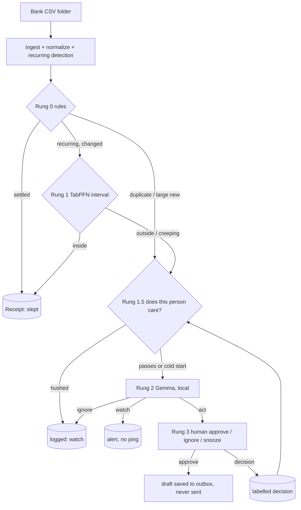

# Architecture

Temporal wraps the nightly run: `SlothNightly` workflow = pipeline activity (idempotent per window) -> notify activity ->
durable wait (7d) for an approve/ignore/snooze signal -> decision activity. Every run writes a hash-chained receipt.

| Module | Job |
|---|---|
| `ingest.py` | CSV quirks, never mutates the source |
| `normalize.py` | merchant cleaning (conservative grouping), categories, recurring detection |
| `rules.py` | Rung 0 |
| `forecast.py` | Rung 1: TabPFN or robust median+MAD, creeping detector |
| `care.py` | Rung 1.5: learns from your decisions (TabPFN classifier or kNN) |
| `llm.py` | Rung 2: Ollama/Gemma, strict JSON, retry, labelled template fallback |
| `ladder.py` | pure orchestration of the rungs |
| `runner.py` | persistence, idempotency, receipts, decisions |
| `receipts.py`, `canary.py` | trust layer |
| `workflows.py` | Temporal |
| `dashboard.py` / `.html` | localhost UI |
| `demo/` | generator, scenarios, diary, tour, 12-week simulation |
| `bench.py`, `tuning/` | benchmarks and Rung-2 tuning harness |
